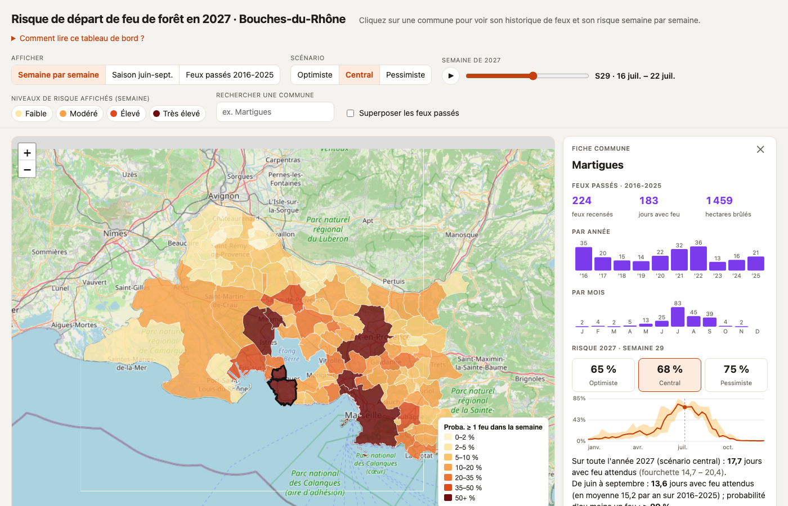
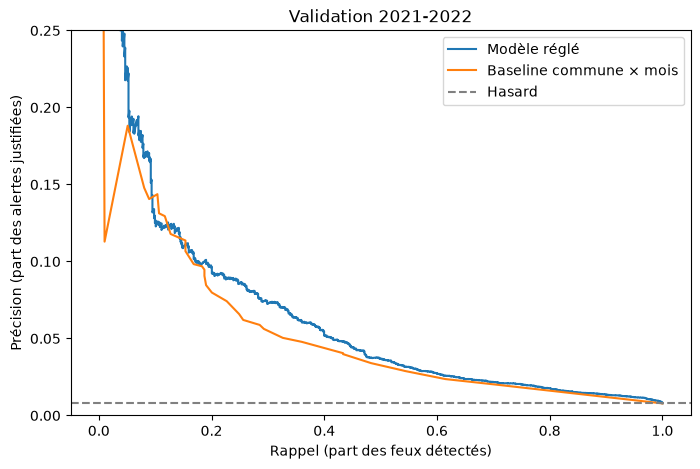
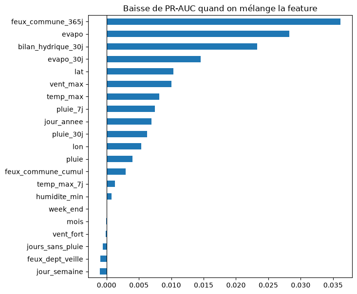
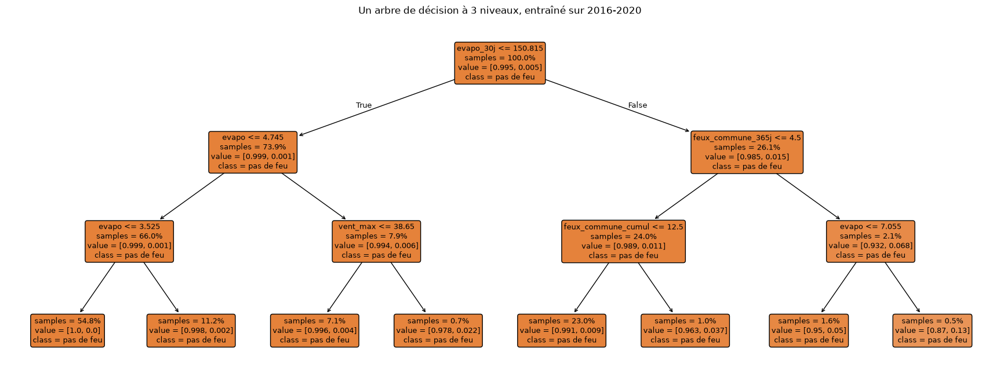
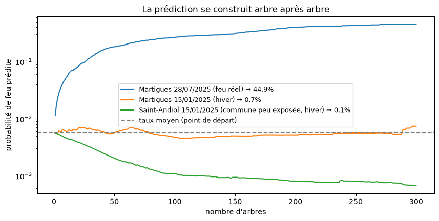
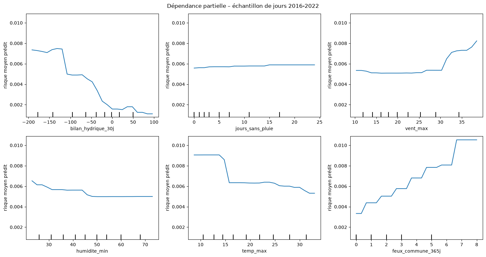
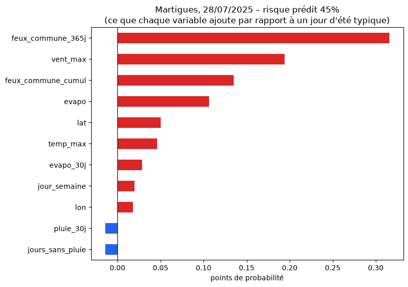
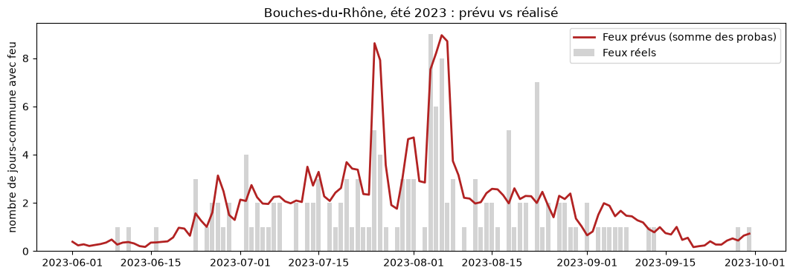
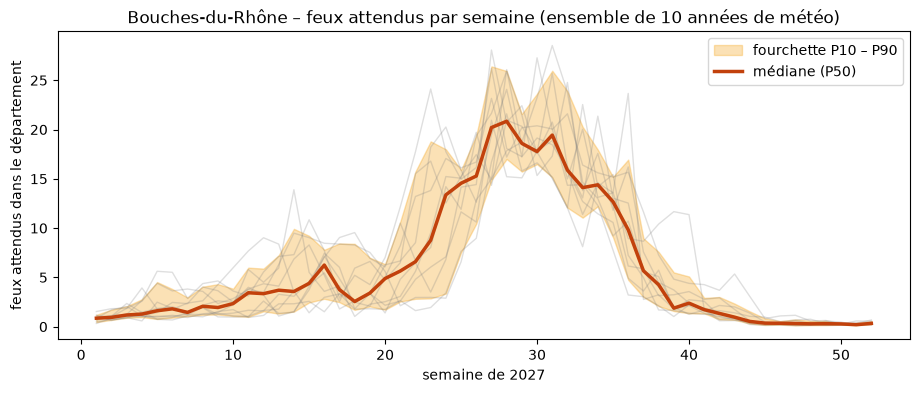
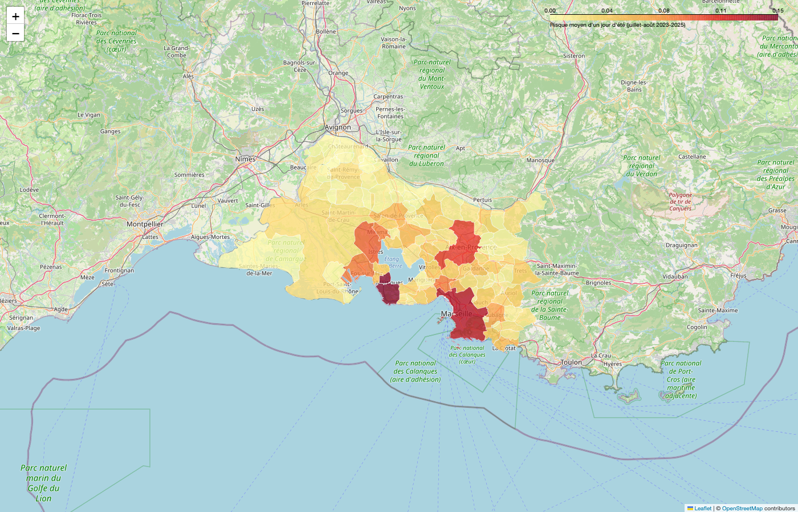

# 🔥 Prédire le risque de départ de feu de forêt – Bouches-du-Rhône

> **Quelle est la probabilité qu'un feu démarre dans une commune donnée, un jour donné ?**

Modèle de machine learning qui estime, pour chacune des 119 communes des Bouches-du-Rhône et chaque jour, la probabilité d'au moins un départ de feu de forêt, à partir de 10 ans de feux réels (BDIFF) et de météo journalière (Open-Meteo / ERA5).

**👉 [Ouvrir la carte interactive des scénarios 2027](outputs/carte_scenarios_2027.html)** · [version en ligne](https://tomsduval-fr.github.io/incendies/outputs/carte_scenarios_2027.html)



---

## En bref

| | |
|---|---|
| **Données** | 2 699 feux de forêt (2016-2025) · 119 communes · 5 variables météo journalières |
| **Table d'entraînement** | 434 707 lignes *commune × jour*, dont **0,57 %** avec feu |
| **Modèle** | `HistGradientBoostingClassifier` (scikit-learn), 21 features |
| **Évaluation** | découpage temporel : entraînement 2016-2020, validation 2021-2022, **test 2023-2025** |
| **Résultat (test)** | PR-AUC **0,063** contre 0,040 pour la baseline (**+57 %**) · en surveillant 5 % des couples commune × jour, on couvre **42 % des feux** |
| **Livrable** | carte web interactive : risque hebdomadaire 2027 par commune, en scénario optimiste / central / pessimiste (ensemble de 10 années de météo) |

---

## La démarche

Le projet est découpé en 9 notebooks, rédigés comme un cours (chaque étape explique le *pourquoi* avant le code).

| # | Notebook | Ce qu'il fait |
|---|---|---|
| 01 | [Exploration](notebooks/01_exploration.ipynb) | 27 444 feux en France : saisonnalité, variabilité annuelle, causes. Choix des Bouches-du-Rhône (1ᵉʳ département en nombre de feux, 119 communes). |
| 02 | [Table commune × jour](notebooks/02_dataset.ipynb) | Liste complète des communes (geo.api.gouv.fr), produit cartésien communes × jours, cible `feu` = 1 si au moins un départ ce jour-là. |
| 03 | [Météo](notebooks/03_meteo.ipynb) | 5 variables journalières Open-Meteo. Contournement des limites de l'API en téléchargeant par case de grille de 0,1° (52 cases), avec cache. |
| 04 | [Features](notebooks/04_features.ipynb) | Fenêtres glissantes par commune (pluie 7/30 j, évapotranspiration, **bilan hydrique**), jours depuis la dernière pluie, vent fort, historique de feux **décalé d'un jour** pour éviter toute fuite de données. |
| 05 | [Baseline](notebooks/05_baseline.ipynb) | Référence sans ML : taux de feu historique par commune × mois. Découpage temporel, PR-AUC. |
| 06 | [Modèle](notebooks/06_modele.ipynb) | Gradient boosting, diagnostic de surapprentissage, réglage des hyperparamètres sur la validation, importance par permutation, évaluation unique sur le test. |
| 07 | [Cartes](notebooks/07_carte.ipynb) | Prévu vs réalisé, calibration, cartes folium du risque d'un jour donné et atlas du risque estival. |
| 08 | [Scénarios 2027](notebooks/08_scenarios_2027.ipynb) | Planification par scénarios : le modèle est rejoué avec la météo de chacune des 10 années, résumée en quantiles P10 / P50 / P90 ; génération de la page web interactive. |
| 09 | [Comprendre le modèle](notebooks/09_comprendre_le_modele.ipynb) | Un arbre de décision dessiné et suivi à la main, un gradient boosting codé en 10 lignes, dépendance partielle, explication d'une prédiction (« et si… ? »). |

### Choix de méthode clés

- **Une ligne = une commune × un jour.** La BDIFF ne liste que les jours *avec* feu : il a fallu fabriquer tous les jours *sans* feu pour que le modèle puisse comparer.
- **Pas de fuite de données.** Toute feature dérivée des feux (historique de la commune, activité du département) est calculée **jusqu'à la veille** (`shift(1)`). La météo du jour est autorisée : elle correspond à la prévision disponible le matin.
- **Découpage temporel, jamais aléatoire.** On apprend sur le passé et on évalue sur le futur ; le jeu de test 2023-2025 n'a été ouvert qu'une fois, après tous les choix.
- **PR-AUC plutôt qu'accuracy.** Avec 0,57 % de positifs, un modèle qui répond toujours « pas de feu » aurait 99,4 % d'accuracy et ne servirait à rien.
- **Une baseline d'abord.** Le modèle n'a de valeur que s'il bat une règle simple (« taux historique de la commune ce mois-ci »).

---

## Résultats

### Le modèle bat la baseline, globalement et chaque année

| Jeu de test 2023-2025 (728 jours-commune avec feu) | PR-AUC | Feux couverts en surveillant le top 5 % |
|---|---|---|
| Hasard | 0,006 | 5 % |
| Baseline : taux historique commune × mois | 0,040 | 38 % |
| **Gradient boosting** | **0,063** | **42 %** |

Le modèle fait mieux que la baseline sur chacune des trois années de test. Avec les réglages par défaut, il **surapprenait** (PR-AUC 0,23 en entraînement contre 0,034 en validation, sous la baseline) ; le contraindre fortement (7 feuilles par arbre, au moins 1 000 exemples par feuille) a été décisif, car les feux sont rares.



### Ce que le modèle a appris



1. **L'historique récent de la commune** (jours avec feu sur les 365 derniers jours) : *où* compte plus que *quand*.
2. **La sécheresse de la végétation** : évapotranspiration et **bilan hydrique sur 30 jours** (pluie − évapotranspiration), une variable « métier » proche des indices de danger feu officiels.
3. **Le vent** et **la position géographique**.

Le risque n'augmente pas indéfiniment avec la sécheresse : au-delà de ~60 jours sans pluie, le taux de feu redescend (sécheresses hivernales, végétation déjà brûlée). Les arbres de décision captent ce type de relation non linéaire, qu'une règle simple manque.

### Comment le modèle fonctionne (notebook 09)

**Un arbre de décision** choisit lui-même les questions qui séparent le mieux jours avec et sans feu. Entraîné seul sur 2016-2020, il découvre la sécheresse cumulée, l'historique de la commune, l'évapotranspiration du jour et le vent :



**Le gradient boosting** enchaîne 300 petits arbres de 7 feuilles, chacun entraîné sur les **erreurs** des précédents, avec un pas de 0,03. Pour Martigues le 28 juillet 2025 (feu réel), la prédiction part du taux moyen (0,6 %) et monte arbre après arbre jusqu'à 45 % ; pour une petite commune agricole en hiver, elle descend sous 0,1 % :



**Ce que le modèle a appris**, variable par variable (dépendance partielle) : le risque est multiplié par ~6 quand le bilan hydrique passe de positif à −100 mm, grimpe au-delà de 30 km/h de vent et triple avec l'historique de la commune. La courbe de température, qui descend, rappelle que ces graphiques décrivent le **modèle** et non le monde : l'effet de la chaleur passe par l'évapotranspiration et l'humidité, qui lui sont corrélées.



**Expliquer une prédiction** : ce jour-là à Martigues, l'historique chargé de la commune et le vent à 45 km/h expliquent l'essentiel du risque. Avec un vent faible, le modèle aurait prédit 26 % au lieu de 45 % ; avec une commune sans feu dans l'année, 11 %.



### Prévu vs réalisé



En additionnant les probabilités des 119 communes, on obtient un nombre de feux attendu par jour. Le modèle suit bien les **épisodes dangereux** (vagues de chaleur, mistral), mais **surestime le niveau global d'environ 25 %** (920 prévus pour 728 réels sur 2023-2025) : il classe bien, mais il est mal **calibré**, probablement à cause de l'année record 2022 dans ses données d'entraînement.

---

## La carte des scénarios 2027

La météo de 2027 étant inconnue, la carte ne prétend pas prédire un jour précis. Elle répond à une question de **planification** : *« dans une année typique – ou dans une mauvaise année sur dix – quelles communes surveiller, et à partir de quelle semaine ? »*

- **Un ensemble plutôt qu'une année.** Le modèle (réentraîné sur 2016-2025) est rejoué avec la météo réelle de **chacune des 10 années** : 10 futurs possibles pour 2027. L'historique de feux des communes est celui connu fin 2025 ; seule la météo varie.
- **Trois niveaux**, calculés pour chaque commune et chaque semaine : **optimiste** (P10, 1 année sur 10 fait mieux), **central** (médiane), **pessimiste** (P90, 1 année sur 10 fait pire). Pour le département, les quantiles portent sur les totaux de chaque année (on n'additionne pas des P90 communaux).
- **Indicateur** : probabilité d'au moins un départ de feu dans la commune pendant la semaine, `1 − ∏(1 − p_jour)`.
- **Tableau de bord** : trois modes d'affichage (risque semaine par semaine · jours avec feu attendus sur la saison juin-septembre · feux passés 2016-2025), choix du scénario, curseur et animation des semaines, filtre par niveau de risque, recherche de commune, superposition des feux passés.
- **Fiche commune** (clic sur la carte) : nombre de feux recensés, jours avec feu et hectares brûlés de 2016 à 2025, répartition par année et par mois ; risque 2027 semaine par semaine avec sa fourchette optimiste – pessimiste, et nombre de jours avec feu attendus sur l'année.
- **Technique** : le modèle Python ne tourne pas dans le navigateur ; les ~18 600 valeurs (3 niveaux × 119 communes × 52 semaines) sont précalculées et injectées dans une page HTML autonome (Leaflet), hébergeable gratuitement.

Pourquoi un ensemble ? Une première version associait un scénario à une année « étiquetée » (été sec = 2017, caniculaire = 2022…). Or rejouer la météo de 2022, l'année record de feux réels, ne donne **pas** le pire été selon le modèle :

| Météo rejouée | 2018 | 2024 | 2025 | 2021 | 2020 | 2023 | 2016 | 2019 | 2022 | 2017 |
|---|---|---|---|---|---|---|---|---|---|---|
| Feux attendus sur l'année* | 249 | 256 | 290 | 305 | 327 | 329 | 347 | 370 | 374 | 378 |
| dont juillet-août | 131 | 141 | 151 | 153 | 177 | 165 | 168 | 155 | 150 | 172 |

<sub>*jours-commune avec au moins un départ de feu ; niveau à lire avec la réserve de calibration ci-dessus.</sub>

Un été, c'est un seul tirage (le calendrier des coups de mistral et des canicules) : résumer l'ensemble par des quantiles est plus robuste, et montre l'incertitude – comme une prévision de demande par quantiles.



### Atlas du risque estival

Risque moyen d'un jour d'été (juillet-août 2023-2025) : l'axe Marseille – étang de Berre – Martigues – Istres et Aix-en-Provence ressortent, la plaine agricole du nord reste pâle. Le classement des communes par risque prédit suit de près leur nombre réel de jours avec feu (corrélation de rang ≈ 0,78).



Autres cartes (folium) : [atlas du risque estival 2023-2025](outputs/atlas_risque_ete.html) · [6 août 2023](outputs/carte_risque_2023-08-06.html) · [16 juillet 2025, journée record](outputs/carte_risque_2025-07-16.html).

---

## Limites et pistes d'amélioration

- **Calibration** : le niveau de risque est surestimé d'environ 25 % → recalibration (isotonique ou Platt) sur une période récente.
- **Journées extrêmes** : le 16 juillet 2025 (11 feux), le modèle en attendait ~6 ; il avait bien repéré les communes concernées (Martigues et Marseille en tête), pas l'ampleur.
- **Résolution météo** : ~10 km, des communes voisines partagent la même météo. Les données de vent ne capturent pas finement le mistral local.
- **Facteur humain** : 90 % des feux sont d'origine humaine ; aucune variable ne décrit directement la fréquentation, les routes ou l'interface habitat-forêt (pistes : densité de population, occupation du sol Corine Land Cover, jours fériés et vacances).
- **Scénarios** : l'ensemble ne compte que 10 années et rejoue des étés passés ; avec le réchauffement climatique, 2027 pourrait sortir de cette plage. Piste : le modèle a besoin des feux pour apprendre (BDIFF : 2016 →), mais les scénarios n'ont besoin que de météo, disponible depuis 1940 → un ensemble de 30 étés récents, éventuellement pondérés vers les plus récents.
- **Jours supposés indépendants** dans le calcul hebdomadaire.
- **Extension opérationnelle** : remplacer la météo des scénarios par les prévisions Open-Meteo à 7-16 jours pour une carte de risque « la semaine prochaine ».

---

## Structure du dépôt

```
incendies/
├── notebooks/        # 01 → 09, à exécuter dans l'ordre
├── src/
│   └── carte_scenarios_template.html   # gabarit HTML/JS de la carte 2027
├── outputs/          # cartes HTML interactives
├── images/           # figures du README
├── data/             # non versionné (régénéré par les notebooks 01 → 04)
│   ├── raw/          #   export BDIFF, cache météo, contours des communes
│   └── processed/    #   tables intermédiaires (CSV)
└── requirements.txt
```

## Reproduire le projet

1. Exporter les feux depuis la [BDIFF](https://bdiff.agriculture.gouv.fr) : type de feu « Forêt », France entière, 01/01/2016 → 31/12/2025, format CSV. Enregistrer le fichier sous `data/raw/Incendies.csv`.
2. Installer l'environnement (Python 3.13) :
   ```bash
   python3 -m venv .venv
   source .venv/bin/activate
   pip install -r requirements.txt
   ```
3. Exécuter les notebooks de `notebooks/` **dans l'ordre**, depuis ce dossier. Le premier téléchargement météo (notebook 03) peut prendre plus d'une heure à cause des limites de l'API gratuite ; les exécutions suivantes utilisent le cache.

## Sources des données

| Donnée | Source | Licence |
|---|---|---|
| Feux de forêt | [BDIFF](https://bdiff.agriculture.gouv.fr) – Ministère de l'Agriculture | données publiques |
| Météo journalière | [Open-Meteo](https://open-meteo.com) – réanalyses ERA5 / ERA5-Land (Copernicus) | CC BY 4.0 |
| Communes et contours | [geo.api.gouv.fr](https://geo.api.gouv.fr) | Licence Ouverte Etalab 2.0 |
| Fond de carte | © contributeurs [OpenStreetMap](https://www.openstreetmap.org/copyright) | ODbL |

## Outils

Python 3.13 · pandas · scikit-learn · matplotlib · folium · Leaflet · requests-cache · Jupyter
